# Cooking Guide — step by step (read aloud)

For a voice assistant: read **one stage at a time**. Say the stage name, the equipment, then each step as a short sentence. Wait for "next" before moving on. **Always read the safety checkpoint out loud.** Full recipes and amounts: `2026-10-31_Cook_Day_1.md` (today) and `2026-11-01_Cook_Day_2_New_Recipes.md` (Sunday).

**Feasibility note:** the times are planning estimates. This schedule hasn't been run in this kitchen yet. Today's estimate is about 2 h 25 min active, against a 2 h 30 min cap.

## Today at a glance — Saturday 2026-10-31

```mermaid
gantt
    title Cook Day 1 (minutes from start)
    dateFormat HH:mm
    axisFormat %H:%M
    section Unattended
    Pressure-cooker chicken       :00:00, 32m
    Oven chicken (400F, covered)  :00:00, 35m
    Mushrooms cook down           :00:32, 23m
    section Hands-on
    Load chicken                  :00:00, 10m
    RAW bags (raw zone)           :00:10, 20m
    Onions + mushrooms + pasta    :00:30, 10m
    Shred + enchilada filling     :00:40, 20m
    Finish sauce                  :01:00, 15m
    Assemble Tetrazzini + Tater   :01:15, 20m
    Lid, label, fridge/freezer    :01:35, 15m
    Roll enchiladas               :01:50, 25m
    Clean up                      :02:15, 10m
```

| Food state | What |
|---|---|
| **A. Fully prepared today** | **None.** Nothing made today is ready to eat |
| **B. Assembled, needs baking** | Tetrazzini ×4, Tater Tot ×4, Enchiladas Verde ×4 (2 cheese, 2 no-cheese) |
| **C. RAW prep bags** | Beef-Broccoli-Mushroom ×2, Chicken-Mushroom-Green Bean ×2 |
| **D. Deferred to Sunday** | Braised Short Ribs ×3, Creamy Ground Beef Noodles ×3. Enchiladas only if the safety valve is used |

---

### Stage 1 · 0:00–0:10 · Start the chicken
**Equipment:** Midea pressure cooker, oven at 400°F, 9×13 dish, foil.
**Ingredients:** 6½–7 lb chicken breasts, 2 cups unsalted broth.
1. Turn the oven to 400 degrees.
2. Put about half the chicken in the pressure cooker. Add one and a half cups of broth.
3. Check the chicken is below the two-thirds line. Lock the lid. High pressure, 12 minutes, then natural release.
4. Put the rest of the chicken in the baking dish with half a cup of broth. Cover with foil. Into the oven for 35 minutes.
5. Wash your hands with soap.
🛑 **Safety:** raw chicken juices. Wash your hands and anything the raw chicken touched.

### Stage 2 · 0:10–0:30 · Raw bags (raw zone)
**Equipment:** raw-meat cutting board, knife, 4 gallon freezer bags, marker.
**Ingredients per beef bag:** 1 lb beef strips, 8 oz mushrooms, 2 Tbsp coconut aminos, 1 Tbsp rice vinegar, 2 Tbsp honey, 1½ Tbsp ginger paste, ¼ tsp garlic powder, 1 tsp sesame oil, ½ cup unsalted broth.
**Ingredients per chicken bag:** 1¼ lb thighs in 1½-inch pieces, 8 oz mushrooms, 12 oz green beans, 2 Tbsp olive oil, 1½ tsp Italian seasoning, ½ tsp onion powder, ¼ tsp garlic powder, ¼ tsp salt, ¼ tsp pepper.
1. Write RAW BEEF on two bags and RAW CHICKEN on two bags, with today's date.
2. Fill the beef bags. Fill the chicken bags.
3. Squeeze out the air. Lay them flat in the freezer.
4. Wash and sanitize the board, the knife, the counter and your hands.
🛑 **Safety:** finish all raw work **before** touching any cooked food.

### Stage 3 · 0:30–0:40 · Onions, mushrooms, pasta water
**Equipment:** food processor, Dutch oven, medium pot.
**Ingredients:** 2 onions, 2½ lb sliced mushrooms, 5 Tbsp olive oil (or 7 Tbsp Smart Balance if you have it).
1. Dice the onions in the food processor.
2. Heat the oil in the Dutch oven over medium-high. Add the onions and mushrooms.
3. Fill the pasta pot with water and put it on high.
4. Stir the mushrooms every few minutes. They take 15 to 20 minutes.

### Stage 4 · 0:40–1:00 · Shred the chicken and make the enchilada filling
**Equipment:** thermometer, 2 forks or stand mixer, sheet pan, large bowl.
**Ingredients:** filling: 5 cups chicken, ½ cup salsa verde, ½ cup sour cream, 1 cup frozen corn, 1 tsp cumin. Pasta: 12 oz GF spaghetti.
1. Check the thickest piece of chicken from **both** batches. It must read 165 degrees or more.
2. **Write down the time.** Everything must be in the fridge or freezer within 2 hours of this time.
3. Shred the chicken.
4. Mix 5 cups of chicken with the salsa, sour cream, corn and cumin. Cover it. Put it in the fridge now.
5. Spread the rest of the chicken on the sheet pan to cool.
6. Cook the pasta 2 to 3 minutes less than the box says. Drain and rinse it with cool water.
🛑 **Safety:** 165°F on both batches. Rinse and sanitize the thermometer probe.

### Stage 5 · 1:00–1:15 · Finish the mushroom sauce
**Ingredients:** ⅔ cup GF flour, 5 cups unsalted broth, 3 cups 2% milk, 2 tsp thyme, 1½ tsp onion powder, ½ tsp garlic powder, ¾ tsp salt, 1 tsp pepper.
1. When the mushroom liquid is mostly gone, stir in the flour for one minute.
2. Slowly whisk in the broth, then the milk.
3. Simmer and stir about 5 minutes, until it coats a spoon.
4. Taste it. Add salt only if it needs it.
5. Scoop about 5 cups into a bowl for the Tater Tot casserole.

### Stage 6 · 1:15–1:35 · Assemble Tetrazzini and Tater Tot
**Equipment:** 8 foil pans with lids.
**Tetrazzini:** the sauce left in the pot + ¼ cup nutritional yeast + 4 cups chicken + the pasta + 1½ cups frozen peas → 4 pans, about 4 cups each.
**Tater Tot:** the 5 cups of sauce + 4 cups chicken + 4 cups frozen mixed vegetables → 4 pans. **No tots yet.**
1. Stir the Tetrazzini together in the pot and divide it into 4 pans.
2. Mix the Tater Tot filling and divide it into 4 pans.

### Stage 7 · 1:35–1:50 · Lid, label, chill
1. Lid and label all 8 pans. Write "cooked, not baked" and the bake directions.
2. Tetrazzini pans go **straight to the freezer**, spread out in one layer.
3. Tater Tot pans go in the **fridge**, spread out, lids slightly open.
🛑 **Safety:** check the clock against the time you wrote down in Stage 4.

### Stage 8 · 1:50–2:15 · Roll the enchiladas
**Decision point:** if it's past 1:55 on your timer, put the filling back in the fridge and stop. You'll roll the enchiladas Sunday.
**Equipment:** 4 foil pans, microwave, damp paper towel.
**Ingredients:** 16 corn tortillas, the cold filling, about 1½ cups salsa verde, 1½ cups Monterey Jack (2 pans only).
1. Microwave 8 tortillas at a time in a damp paper towel for 45 seconds.
2. Spread 2 tablespoons of salsa in each pan.
3. Fill each tortilla with about a third of a cup of filling. Roll it. Seam side down. Four per pan.
4. Top each pan with about a third of a cup of salsa.
5. Cheese on two pans only. Label those CHEESE and the other two NO CHEESE.
6. Lid them and put them straight in the freezer.

### Stage 9 · 2:15–2:25 · Clean up
1. Wash the colander, spoons, food processor and boards.
2. Sanitize the counters.

### Stage 10 · +1 to 2 hours · Finish the Tater Tot pans
1. Check a Tater Tot pan with the thermometer. It must be 40 degrees or colder.
2. Cover about three-quarters of the top with frozen tots.
3. Lid them and freeze them in one layer.

---

## Sunday at a glance — 2026-11-01 (about 70 min active)

```mermaid
gantt
    title Cook Day 2 (minutes from start)
    dateFormat HH:mm
    axisFormat %H:%M
    section Unattended
    Short ribs braise (300F oven)   :00:45, 200m
    section Hands-on
    Bloom gelatin + sear ribs       :00:00, 25m
    Aromatics + reduce + into oven  :00:25, 20m
    Stroganoff (beef, mushrooms, sauce) :00:50, 30m
    Pack stroganoff                 :01:20, 10m
    Ribs out, strain, chill         :04:05, 10m
```

Monday: about 15 minutes to defat, reduce, pack and freeze the ribs.

### Stage S1 · Sear the short ribs
**Equipment:** Dutch oven, oven at 300°F, tongs, sheet pan.
1. Sprinkle the gelatin over half a cup of cold beef broth. Let it sit.
2. Pat the short ribs very dry. Season them with salt and pepper.
3. Sear them in two or three batches, three to four minutes per side, until deep brown.
4. Pour off all but one tablespoon of fat.
🛑 **Safety:** raw beef. Switch to clean tongs afterward.

### Stage S2 · Build the braise
1. Cook the onion, carrot and celery for six to eight minutes.
2. Add the tomato paste and garlic. Stir two minutes, until it turns brick red.
3. Add one cup of broth. Scrape the bottom. Boil until it's reduced by half.
4. Add the rest of the broth, the gelatin, coconut aminos, one tablespoon of vinegar, the thyme and the bay leaves.
5. Put the ribs back in, bone side up. Cover. Oven at 300 degrees for three to three and a half hours.

### Stage S3 · Creamy Ground Beef Noodles (during the braise)
1. Brown two pounds of ground beef in two batches. It's done at 160 degrees with no pink. Drain the fat.
2. Cook the mushrooms and onion 12 to 15 minutes, until browned.
3. Add the garlic, paprika and thyme for one minute. Then the flour for one minute.
4. Whisk in the broth, coconut aminos, vinegar and mustard. Simmer until thick.
5. Return the beef. Simmer five minutes. Taste it.
6. Divide into three containers. **No sour cream, no noodles.** One goes in the fridge, two in the freezer.
🛑 **Safety:** in the fridge within 2 hours.

### Stage S4 · Short ribs out
1. Test with a fork. It should slide in with almost no resistance.
2. Lift the ribs into a shallow container. Strain the liquid into another container.
3. Refrigerate both within two hours. Leave them overnight.

### Stage M1 · Monday · Finish the ribs (about 15 min)
1. Lift off the hard fat.
2. Simmer the sauce until it lightly coats a spoon. Taste it. Add half a teaspoon of vinegar if it needs brightness.
3. Pack two ribs and two-thirds of a cup of sauce per container. Label and freeze.

## Reheating, every meal
**Every cooked meal is reheated to 165°F in the center.** Raw-bag chicken is cooked to 165°F. Raw-bag beef is cooked to 145°F with a 3-minute rest.
